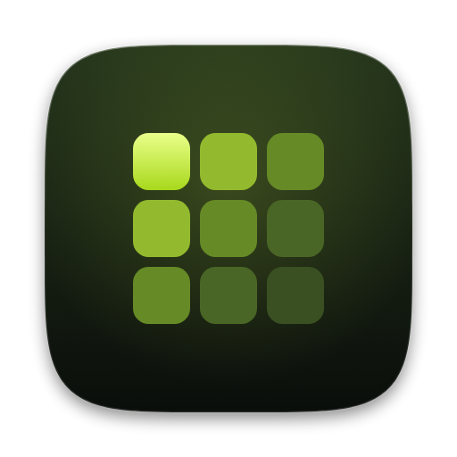
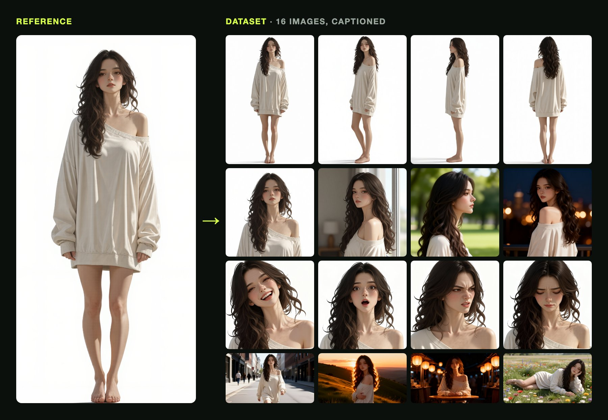

<p align="center">
  
</p>

<h1 align="center">Character Lab</h1>

<p align="center"><strong>One character image in, a training-ready LoRA dataset out.</strong></p>

<p align="center">
  <a href="https://github.com/DeniisPyr/Character-Lab/actions/workflows/ci.yml"></a>
  <a href="https://github.com/DeniisPyr/Character-Lab/releases/latest"></a>
  <a href="https://deniispyr.github.io/Character-Lab/"></a>
</p>

Give Character Lab one image of your character. It makes 16 new images of the same character
in four kinds of shots with [Qwen-Image-Edit-2511](https://huggingface.co/Qwen/Qwen-Image-Edit-2511),
checks each one, captions it, and writes image/caption pairs ready for a LoRA trainer such as
ai-toolkit or kohya.

<p align="center">
  <a href="https://deniispyr.github.io/Character-Lab/"></a>
</p>

<p align="center"><sub>A real run with the default settings, not retouched. Every image, with its caption and
scores, is on the <a href="https://deniispyr.github.io/Character-Lab/">showcase page</a> and in
<a href="examples/diana">examples/diana</a>.</sub></p>

## Quick start

You need Python 3.11+ and an NVIDIA GPU with 80 GB of memory, or 24 GB in the quantized mode
(see [Requirements](#requirements)). On macOS or Linux:

```sh
git clone https://github.com/DeniisPyr/Character-Lab.git
cd Character-Lab
python3 -m venv .venv && source .venv/bin/activate
pip install -e './backend[gpu]'

charlab generate reference.png --trigger diana   # the dataset, in results/diana
```

## What you get

16 images in four kinds of shots:

| Shots | Images | Size |
|---|---|---|
| Turnaround | front, three-quarter, side, back | 832×1216 |
| Portrait | front, three-quarter, profile, over the shoulder | 1024×1024 |
| Expressions | joy, surprise, anger, sadness | 1024×1024 |
| Scenes | city walk, hilltop sunset, lantern market, meadow | 1280×720 |

They are written as numbered image/caption pairs:

```
results/character_name/
  001_turnaround_front.png         the image
  001_turnaround_front.txt         its caption
  ...
  016_scenes_meadow_rest.png
  016_scenes_meadow_rest.txt
  manifest.json                    settings, seeds, prompts and captions
  report.json                      quality check scores
results/character_name.zip         with --zip
```

LoRA trainers pair each image with the `.txt` file of the same name. A caption is the trigger
word, the shot, then a description of the image.

> What the captions never describe, the LoRA learns as part of `character_name`; what they do
> describe, such as the outfit, the pose and the background, stays yours to change in a prompt.

## Requirements

- **Python 3.11 or newer**, on Linux, macOS or Windows.
- **An NVIDIA GPU** to generate images. Pick the mode that fits your card:

| | Standard (default) | 24 GB mode (`gguf`) |
|---|---|---|
| GPU memory | 80 GB, such as an A100 or H100 | 24 GB, such as an RTX 3090 or 4090 |
| One dataset takes | 6.5–15 min | 16–18 min |
| First download | about 60 GB | about 36 GB |

**On a 24 GB GPU**, add `--config 24gb.yaml`:

```sh
charlab generate reference.png --trigger diana --config 24gb.yaml
```

**Good to know:**
- **Most of a run is loading the model.** That depends on the machine: from 3.5 to 11.5
  minutes on the same type of GPU.
- **GPU memory, standard mode:** about 40 GB on average over a run, and 61 GB at the peak,
  while generating.
- **GPU memory, 24 GB mode:** about 11 GB on average over a run, and 21 GB at the peak, so it
  fits a 24 GB card.

## Quality checks

Each image is scored right after it is made. Both models are small and run on the CPU, adding
well under a second per image.

| Check | Passes when | Measured on the example's 16 images |
|---|---|---|
| Same character ([CCIP](https://huggingface.co/deepghs/ccip_onnx), whole image vs the reference) | difference below 0.1785 | 0.008–0.062 |
| Face present ([anime face detector](https://huggingface.co/deepghs/anime_face_detection)) | a face is found; the recipe marks shots from behind as having none | found in all 15 front-facing shots |
| Face size | shorter side of at least 64 px | 84–432 px |
| Face sharpness | at least 0.07× the reference face's | 0.15× and up |

**When a check fails:**
- The image is made again with the seed plus 1000, up to 3 tries.
- This happens before the next image, so later shots built on it use the kept version.
- If no try passes, the best one is kept and named in the summary at the end.

**`report.json`** records every try: its seed, scores, face box and failure reasons. It also
lists near-exact copies of another image, found with an image fingerprint.

**Changing the limits:** they are under `quality:` in
[backend/configs/default.yaml](backend/configs/default.yaml).

## Models and licenses

The code is MIT-licensed ([LICENSE](LICENSE)). The quality checks' image preprocessing
follows DeepGHS's [imgutils](https://github.com/deepghs/imgutils) (MIT). Character Lab
downloads these models at run time:

| Model | Used for | License |
|---|---|---|
| [Qwen/Qwen-Image-Edit-2511](https://huggingface.co/Qwen/Qwen-Image-Edit-2511) | image generation | Apache-2.0 |
| [lightx2v/Qwen-Image-Edit-2511-Lightning](https://huggingface.co/lightx2v/Qwen-Image-Edit-2511-Lightning) | 4-step sampling | Apache-2.0 |
| [unsloth/Qwen-Image-Edit-2511-GGUF](https://huggingface.co/unsloth/Qwen-Image-Edit-2511-GGUF) | `gguf` mode | Apache-2.0 |
| [florence-community/Florence-2-large](https://huggingface.co/florence-community/Florence-2-large) | captions | MIT |
| [deepghs/anime_face_detection](https://huggingface.co/deepghs/anime_face_detection) (`face_detect_v1.4_s`) | quality checks: faces | MIT |
| [deepghs/ccip_onnx](https://huggingface.co/deepghs/ccip_onnx) (`ccip-caformer-24-randaug-pruned`) | quality checks: identity | OpenRAIL |
| [BiRefNet](https://github.com/ZhengPeng7/BiRefNet), via rembg (`birefnet-general`) | background removal | MIT |
